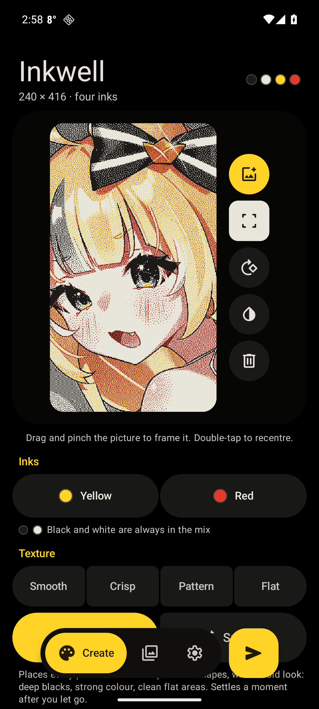
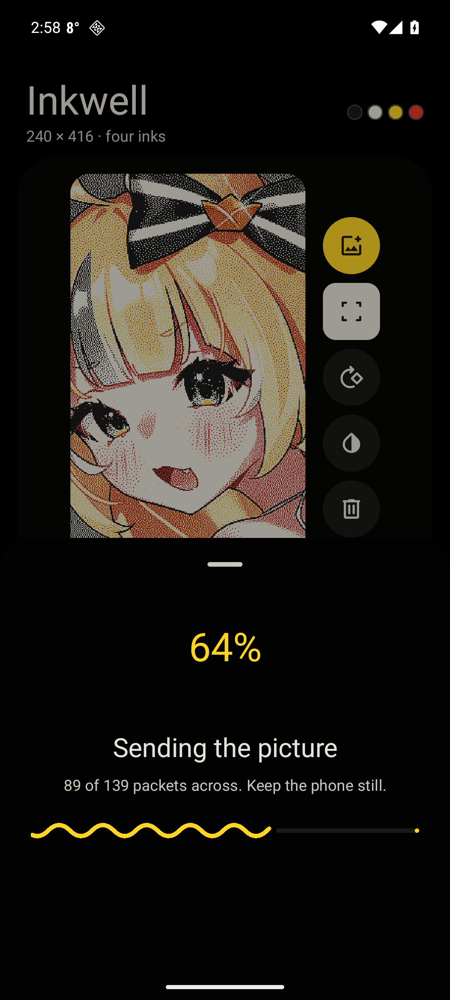
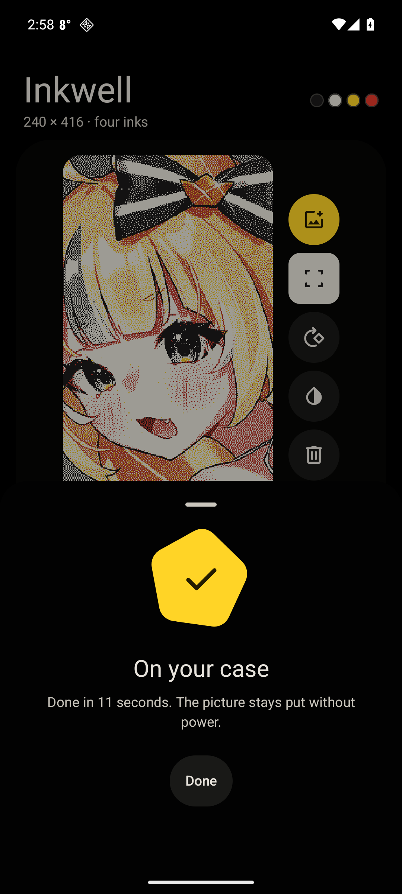
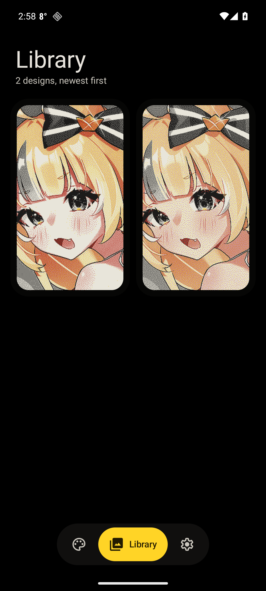
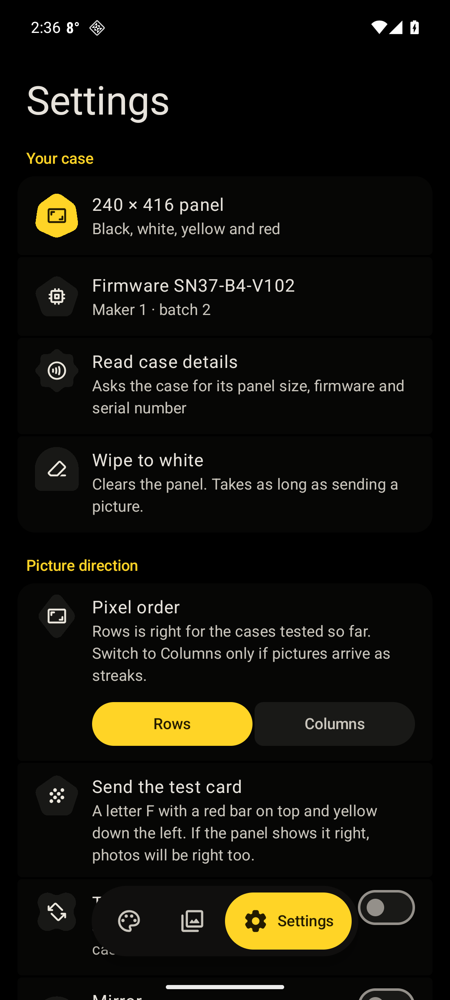
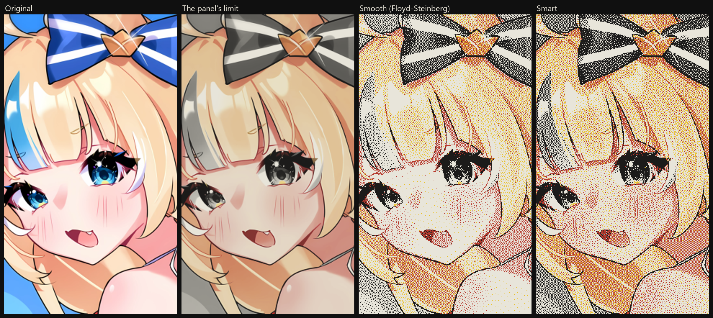
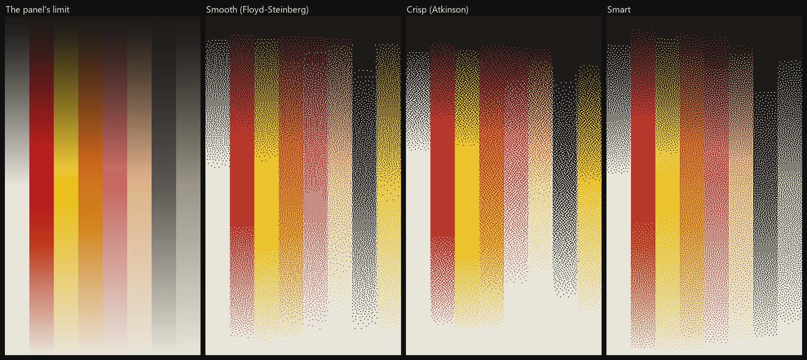
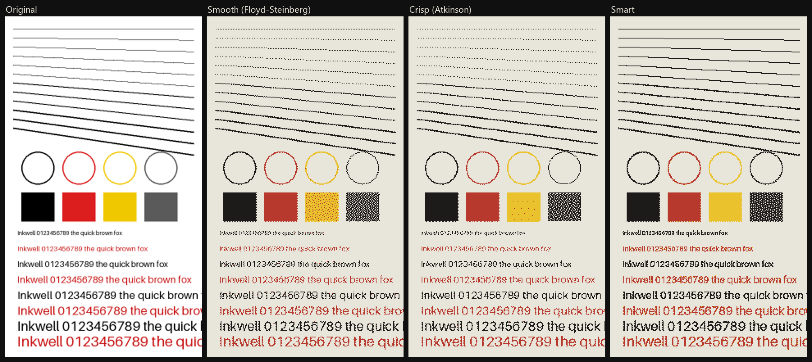

<div align="center">


# Inkwell

**Put any picture on your NFC e-ink phone case.**
A small, private replacement for the apps these cases ship with, built with Material 3 Expressive.
No account, no ads, no tracking.

[](https://github.com/visiuun/inkwell/releases/latest)
[](#compatibility)
[](LICENSE)

### [⬇ Download the latest APK](https://github.com/visiuun/inkwell/releases/latest)

</div>

---

<table>
  <tr>
    <td></td>
    <td></td>
    <td></td>
    <td></td>
    <td></td>
  </tr>
  <tr align="center">
    <td>Live four-ink preview</td>
    <td>Sending</td>
    <td>Done</td>
    <td>Library</td>
    <td>Settings</td>
  </tr>
</table>

## What it does

The cases in question have a battery-free e-ink panel on the back that shows black, white, yellow and red. The phone powers it over NFC for the twenty or so seconds a redraw takes, and the picture then stays without power.

- **A preview that tells the truth.** The photo is reduced to the panel's four inks as you edit, pixel for pixel what the case will draw.
- **Frame it by hand.** Drag and pinch to place the photo, rotate it, fit or fill, white or black backdrop.
- **Two Smart textures.** Both place every pixel deliberately instead of pushing rounding errors along, for sharper lines and calmer flat areas than ordinary dithering. **Smart 1** has a bold look with deep blacks and strong colour. **Smart 2** is worked out against the panel's measured pigments and stays as close to the picture as the case can get. [How they work and how they were tested](#the-study-behind-smart).
- **Four classic textures** as well: Smooth (Floyd–Steinberg), Crisp (Atkinson), Pattern (halftone grid) and Flat for logos and text.
- **Choose your inks.** Switch yellow or red off for a two- or three-colour look.
- **Brightness, contrast and colour** sliders, tuned for how little the panel has to work with.
- **Library.** Every design that reaches the case is kept, so going back to a favourite takes two taps.
- **Share to it.** "Put on my case" shows up in Android's share sheet for images.
- **Wipe to white**, read the case's details, and a test card for checking the panel.
- **Haptics** as the picture goes across and when it lands.
- **Keeps Android quiet.** Android sees the case as an empty NFC tag and keeps opening its own "New tag scanned" screen for it. Inkwell takes the tag instead and shows nothing. If another app on the phone (usually the system's own "Tags") claims the case too, Settings points to it so it can be switched off.
- **Updates itself** from this repository's releases. That is the only thing it goes online for.
- Light, dark and true-black OLED themes.

## The study behind Smart

Every app for these cases has the same job: turn a full-colour picture into 99,840 pixels that can each only be black, white, yellow or red. The usual answer is error diffusion (Floyd-Steinberg, Atkinson), which treats the panel as four ideal colours and pushes each pixel's rounding error onto its neighbours. Smart starts from the panel instead.

There are two Smart textures. This study is about **Smart 2**, the faithful one. **Smart 1** is the first version: it uses the same pixel placement but treats the inks as ideal colours, which makes pictures darker, more contrasty and more saturated than the original. That scores worse here and often looks better, which is why both are in the app.

### What the panel really is

The cases use a 3.7 inch, 416 x 240 panel at 130 dpi. Its datasheet gives the colour of each pigment, and they are a long way from ideal:

| Pigment | CIELAB from the datasheet | Light reflected, with the panel's white as 1 |
|---|---|---|
| White | L* 63 | 1.00 |
| Yellow | L* 54 or more, b* 66, leaning towards orange | 0.70 |
| Red | L* 24 or more, a* 40 | 0.13 |
| Black | L* 9 | 0 (about 1/32 of white in absolute terms) |

Three things follow, and each one is something ordinary dithering gets wrong:

1. **Red is very dark.** It reflects about an eighth of what the white does, where an ideal red would reflect a fifth. A dither that assumes ideal red uses too much of it and the picture comes out dark and heavy.
2. **Dots darken each other.** A half-and-half pattern of black and white looks darker than half the light. Inkwell models this (Yule-Nielsen, exponent about 1.5), so a tone is given the dot density that looks right, not the one that adds up on paper.
3. **Every pixel is visible.** At 130 dpi a single stray dot reads as dirt and a noisy texture reads as noise. Where the dots go matters as much as how many there are.

### What Smart 2 does with that

1. **Keeps thin lines.** The photo is scaled down so that samples which stand out from their surroundings count for more. A line thinner than one panel pixel stays a line instead of fading into a faint smear.
2. **Finds the best mix for every pixel.** For each colour it looks up the mix of the four real pigments that comes closest, in the space where dot patterns actually add up. Colours the pigments cannot make (blue, green, purple) land on the nearest one they can instead of smearing into their neighbours.
3. **Prefers quiet mixes.** Black dots next to white ones are loud, yellow next to white is nearly silent. Smart gives up a little accuracy where that buys a calmer pattern, and drops ink that would only show up as a few stray dots. It never adds an ink a colour does not call for, so greys stay grey.
4. **Places the pixels by search.** Starting from an ordinary diffusion, it changes and swaps pixels for as long as that brings the picture, as the eye blurs it, closer to the target (direct binary search). Brightness is judged through a narrow blur and colour through a wide one, so edges are drawn with the pixels that sit on them while flat areas settle into an even weave.

### What it looks like

"The panel's limit" is the picture with every colour replaced by the nearest one the four pigments can mix, with no dots at all. Nothing shown on this panel can look better than that, so it is the target.



Colour ramps show the tone and colour handling directly. From left to right: grey, red, yellow, orange, pink, skin, blue and green, each running from black through the full colour to white.



Lines from half a panel pixel wide, outlines, solid patches and small text:



### The numbers

Nine test pictures (four illustrations, three photographs, the ramps and the line art) were run through the app's own code, turned into what the eye would see on the panel, and compared with the originals.

| | Colour error | Lightness error | Structure | Edges | Grain in flat areas |
|---|---|---|---|---|---|
| | lower is better | 0 is exact | higher is better | higher is better | lower is better |
| The panel's limit | 1.70 | -0.5 | 0.970 | 0.954 | 0.16 |
| **Smart 2** | **5.12** | **+1.3** | **0.844** | **0.876** | **0.68** |
| Smooth (Floyd-Steinberg) | 5.87 | +2.7 | 0.810 | 0.842 | 0.81 |
| Crisp (Atkinson) | 7.76 | +1.8 | 0.762 | 0.828 | 0.89 |
| Pattern (ordered) | 9.69 | +0.6 | 0.741 | 0.829 | 0.76 |
| Flat (nearest colour) | 14.78 | -1.4 | 0.634 | 0.736 | 0.83 |

Colour error is the mean Oklab distance (x100), structure is SSIM on lightness, edges is the correlation of edge maps, and grain is the lightness noise left inside areas the original has flat. Smart 2 is the best of these on colour, structure, edges and grain. It deliberately comes out slightly lighter than the original and lifts dark pictures, because a reflective panel in room light swallows them otherwise. The gap that remains to the panel's limit is mostly the dots themselves: at 130 dpi they cannot be made invisible.

Either Smart takes about a tenth of a second per picture on a desktop and longer on a phone, against a few milliseconds for the classic textures. While you drag or pinch, the preview shows a quick version and the finished one lands when you let go.

### How far to trust this

The panel model comes from the datasheet and from how pictures looked on a real case, not from measuring a case with an instrument. Panels vary, and the amount by which dots darken each other is an estimate. The scores are from a simulation of the panel built on the same model. If a picture needs a nudge on your case, the brightness, contrast and colour sliders work on top of both Smarts.

As far as we know, Inkwell is the only app for these cases that models the panel or optimises where the pixels go. The scripts used for the study are in [`tools/smart`](tools/smart).

## Compatibility

Inkwell speaks the protocol of the white-label "passive NFC ink screen" cases sold under many names, the ones whose box points to the **SpaceInk**, **SpaceInk+** or **DeerPhoneCase** app (also KAZAVA, Novixand, TYOHINN). They exist for Galaxy S23/S24/S25 Ultra and several iPhones.

| | |
|---|---|
| Confirmed working | Four-colour case for the Galaxy S24 Ultra |
| Should work, not yet confirmed | Other cases that use the same apps |
| Won't work | Cases for other apps (Ink Show, Smart Case, AI Cast and so on) use different chips and protocols |

A quick way to tell: scan the case with any NFC tool. Inkwell's family shows up as a plain **ISO 14443-3A / Type 2** tag whose serial number starts with **1D** (Fudan Microelectronics).

Needs Android 7.0 or newer and a phone with NFC.

### If a picture arrives scrambled or the wrong way round

Settings → **Send the test card** puts a known picture on the case and shows what it should look like. From there:

- streaks instead of a picture: switch **Pixel order** between Rows and Columns
- upside down or mirrored: **Turn upside down** / **Mirror**

If your case needs something other than the defaults, please open an issue with the text from Settings → **Copy case report**.

## Permissions

| Permission | Why |
|---|---|
| NFC | Talking to the case |
| Camera | Optional. A case never leaves the phone, and Android only announces an NFC tag when it arrives. Opening the camera for a blink (no output, nothing captured) makes Android scan again. Inkwell only asks if the case isn't found by itself, and the trick can be switched off |
| Internet, install packages, notifications | Looking for a new release here once a day, and installing it when you say so |

## How it talks to the case

Worked out from the vendor's Android app; none of its code is in here.

1. **Login.** The case's Fudan NFC front end looks like a Type 2 tag. `B0` returns a challenge, `B1` answers it with PRINTcipher-48, `AF E0 01 91` switches the chip into pass-through to the microcontroller behind it.
2. **Handshake.** 32-byte commands starting `00 4A`, AES-128-ECB with a key every case shares. `01 00` returns the firmware name and panel size; the last four bytes of that reply become the session token.
3. **Picture.** Two bits per pixel (`00` black, `01` white, `10` yellow, `11` red), four pixels per byte, sent bottom-right to top-left in 180-byte packets, each followed by a one-byte sum. The case answers every packet with the number it wants next.
4. **Redraw.** The phone keeps the field up and polls `05 00` until the case answers `09 03`.

The whole exchange lives in [`CaseProtocol.kt`](app/src/main/java/com/visiuun/inkwell/nfc/CaseProtocol.kt), with a simulated case and tests beside it.

## Building

```
./gradlew assembleRelease
```

JDK 17 or newer and the Android SDK (compileSdk 37). Without a `keystore.properties` the release build is signed with the debug key. `tools/gen_symbols.py` regenerates the Material Symbols used in the interface.

## License

[CC BY-NC 4.0](LICENSE): use it, change it, share it, with credit, not for money.

Inkwell is an independent project. It is not affiliated with the makers of these cases or their apps; product names are mentioned only to say what it works with.
